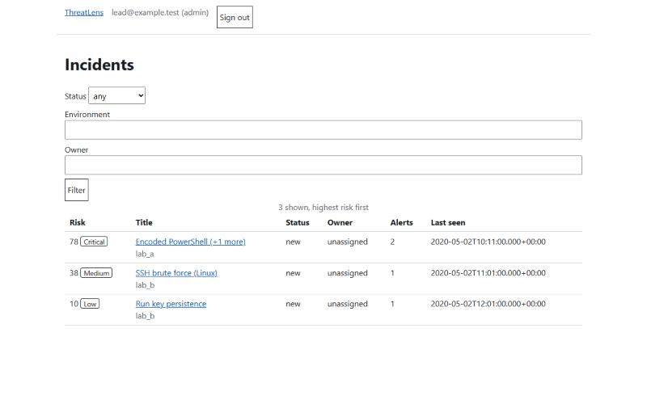
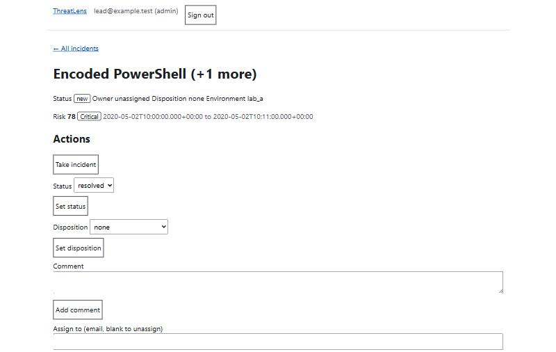
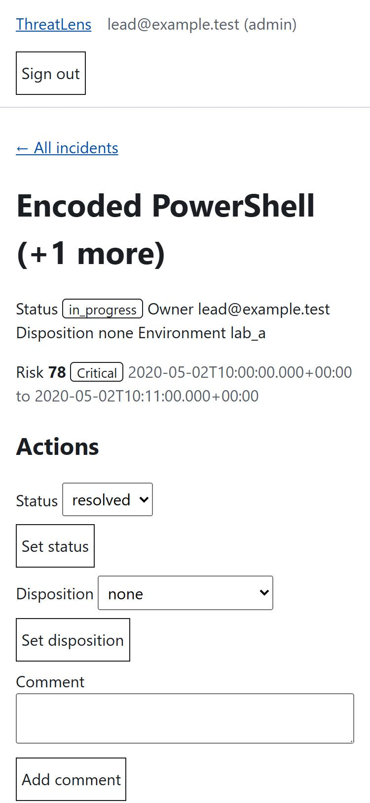

# ThreatLens


> The v1 MVP is frozen at tag `v0.1.0`. This is v2.

ThreatLens is the "handles it" half of the beacon / ThreatLens split: it turns
beacon's findings into prioritised, explained alerts with an analyst incident
workflow. It does no detection of its own.

## Try it

```bash
docker compose up
```

It loads 554 findings from beacon's demo export, correlates them and prints a one-off admin
login in the log. Open `http://127.0.0.1:8000/login`. Data lives in a Docker volume, so a restart
keeps it; `docker compose down -v` wipes it. On this data 554 alerts become 478 incidents (1.2
per incident, because most are SSH guesses from different addresses); the numbers come from
`uv run python scripts/readme_numbers.py`. Why it is built this way: [decisions.md](decisions.md).

## What it does

- **Ingest** beacon findings over an API (bearer key) or `threatlens import`, checked against the beacon contract.
- **Correlate** alerts into incidents, each with a plain-English reason.
- **Score** every incident 0-100 with each factor explained.
- **Work them** in plain HTML pages: take, assign, disposition, comment, merge, split, with four roles and an audit log.
- **Respond** with playbook checklists, printable reports and a `/metrics` page.
- **Feed back** dispositions to beacon with `threatlens export-verdicts`.

Details, one feature at a time: [docs/features.md](docs/features.md). Threat model: [docs/threat-model.md](docs/threat-model.md).

## Screenshots

Queue and incident page on the demo fixtures (admin role, so every form shows):





## Run locally

```powershell
uv sync
make demo
```

Open `http://127.0.0.1:8000/docs` for the API documentation. `make demo` turns the docs on; they are off by default (set `THREATLENS_DOCS=1` to enable them).

Import beacon findings (set `THREATLENS_DB_PATH` first, or pass `--db`):

```powershell
uv run threatlens import tests/fixtures/findings.jsonl
uv run threatlens create-api-key lab_a
uv run threatlens create-admin you@example.test
uv run threatlens audit verify
uv run threatlens user disable you@example.test   # also: enable, revoke-sessions, set-password (prompts; ends their sessions; audited as "cli")
```

Five bad ingest keys from one address in 15 minutes lock that address out of ingest (429, even
with a good key). Sessions write their idle expiry at most every 5 minutes.

Audit anchors (optional, catches a rewrite of the whole database file):

```powershell
uv run threatlens audit keygen C:\secure\audit.key   # once; keep it off this machine's backups
$env:THREATLENS_AUDIT_KEY_FILE = "C:\secure\audit.key"
$env:THREATLENS_AUDIT_ANCHOR = "C:\shipped\anchors.jsonl"
uv run threatlens audit anchor    # run hourly from a scheduler; ship the file off the machine
# Windows: schtasks /create /sc hourly /tn threatlens-anchor /tr "uv run --project <repo> threatlens audit anchor"
# Linux:   0 * * * * cd <repo> && uv run threatlens audit anchor
uv run threatlens audit verify    # also checks the anchors; --max-age 24 (hours)
```

To use a different database path:

```powershell
$env:THREATLENS_DB_PATH = "data\local-threatlens.db"
```

Run the checks:

```powershell
make check
```

## Running behind a TLS proxy

Run uvicorn so it trusts forwarded headers from your proxy and nobody else:

```powershell
uv run uvicorn app.main:app --host 127.0.0.1 --port 8000 --proxy-headers --forwarded-allow-ips=127.0.0.1
```

Put the proxy's own address in `--forwarded-allow-ips`. Never `*`: any client could then forge its
address and dodge the login lock. The proxy must send `X-Forwarded-For` and `X-Forwarded-Proto`,
and pass the original `Host` header through (the same-origin check compares it with `Origin`).
With that, the login lock counts real client addresses, and the session cookie and HSTS are set
for https. The app caps request bodies itself (chunked ones too); a proxy limit is extra.

## Responsible use

ThreatLens is for education and defensive analysis. It stores findings and analyst
notes from telemetry you own or are authorised to test. Do not connect it to systems
or telemetry that you do not own or have explicit permission to test.
