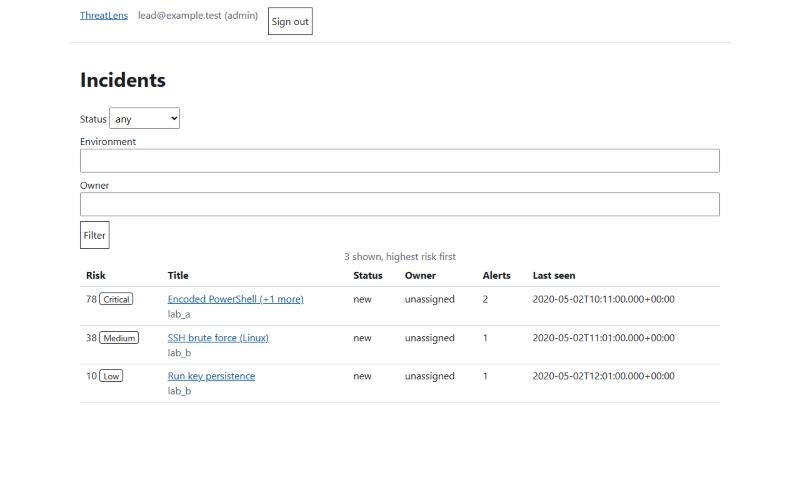
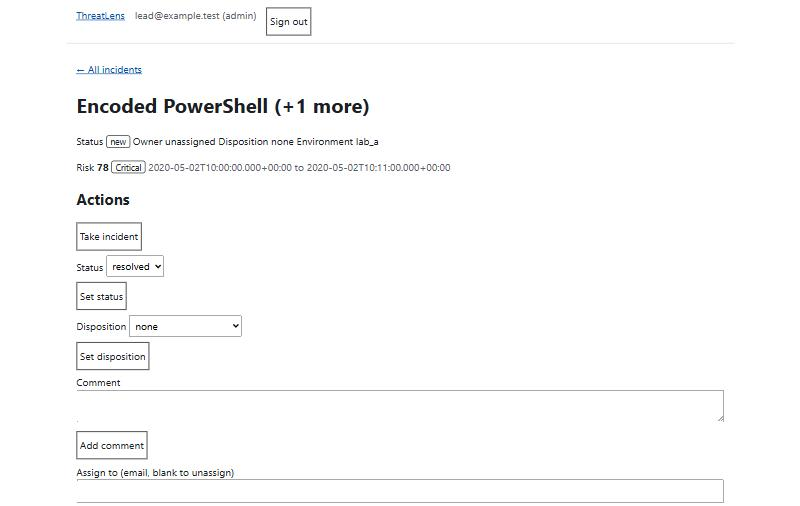
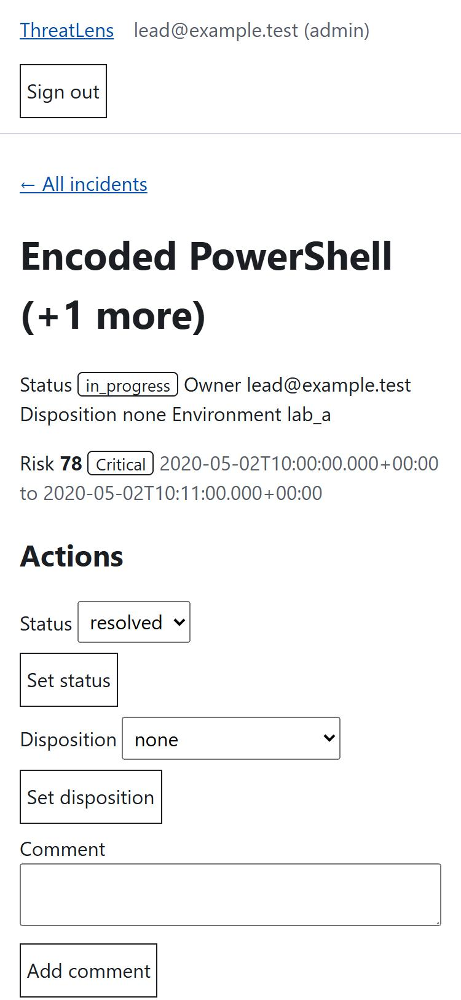

# ThreatLens


> v2 in progress; the v1 MVP is frozen at tag `v0.1.0`.

ThreatLens is the "handles it" half of the beacon / ThreatLens split: it turns
beacon's findings into prioritised, explained alerts with an analyst incident
workflow. It does no detection of its own.

## Current state (v2, M5c done; M5d slices A-C done)

- FastAPI app: `/health`, ingest, and JSON login (`POST /api/v1/login`, `/logout`, `GET /me`).
- SQLite (WAL) with a numbered migrations runner: `app/migrations/NNN_name.sql`,
  versioned by `PRAGMA user_version`.
- Ingest: `POST /api/v1/findings` (bearer API key, 10 MB / 5,000-finding limits,
  all-or-nothing, idempotent by finding uid) and `threatlens import FILE`. Findings are
  validated against the vendored beacon contract v1 (`contracts/`).
- Correlation: after each ingest, alerts of an environment are grouped into incidents. Two
  alerts link when they share a host, user or source IP (not a stoplisted one) and their time
  ranges are within 2 h; incidents are the connected groups, with a plain-English reason per
  alert. Settings: `config/correlation.yml`. Analyst-touched incidents never split, resolved ones
  are frozen, ids are stable. Read-only `GET /api/v1/incidents` and `/{id}` for any logged-in
  role. Measured on beacon's 544-finding export: see [docs/correlation.md](docs/correlation.md).
- Risk score (M4): every incident gets a 0-100 score from its highest alert severity, its
  distinct ATT&CK tactics, Credential Access / Lateral Movement, the most critical asset, a
  privileged identity and a public source IP in an authentication alert. The detail endpoint
  returns `risk_factors` (each with points and a reason, summing to the score) and `risk_label`.
  Weights: `config/risk.yml`. Assets and identities come from CSV files
  (`threatlens load-assets config/assets.csv`, `load-identities`), which replace the table and
  re-score every incident; the demo files are illustrative. IP class uses the standard library
  only, no lookups. ATT&CK 20.0 technique names, tactics and links come from the committed
  `app/data/attack_subset.json` (706 techniques), built by `scripts/build_attack_subset.py` from
  MITRE's bundle after a sha256 check; the incident detail lists them under `techniques`.
- Analyst actions (M5a, JSON only): `POST /api/v1/incidents/{id}/` `take`, `status`, `disposition`,
  `comments` (analyst+; an analyst works only incidents they own) and `assign`, `merge`, `split`
  (lead+). Resolving needs a disposition and copies it to alerts without one; reopening is for
  leads. Each action marks the incident touched and writes an audit row.
- Analyst pages (M5b, M5c): `/login`, `/` (queue by risk; filters status, environment, owner),
  `/incidents/{id}` (risk factors, ATT&CK links, entities with asset, identity and IP context,
  grouping reasons, timeline, comments) and `/alerts/{uid}` (the finding as received). Plain HTML
  forms run the same actions as the JSON API (take, status, disposition, comment; assign, merge,
  split for leads) and sign out. Buttons show only what the role and incident state allow; the
  service still enforces. Forms carry a hidden CSRF field and an Origin check. Jinja2 autoescape,
  no inline script or style, no JavaScript.
- API keys: `threatlens create-api-key NAME` prints a token once; only its hash is stored.
- Admin pages (M5d): a fixed one-shot message after each good action. `/audit` (lead and admin)
  lists the newest 50 audit rows (leads do not see login rows; admins do) and the hash-chain result (new rows checked on every view; the whole chain every 10 minutes, or every view if the append-only triggers are gone).
  `/admin/keys` (admin only) lists, creates and revokes ingest keys; a new token is shown once,
  on the page after the create redirect, and never logged (a 60 s HttpOnly cookie carries it across the redirect; the database never holds it; the cookie is `Secure` off localhost).
  `/admin/users` (admin only) creates users (admin types the first password), changes roles and
  disables or re-enables accounts. You cannot change your own account, and the last active admin
  stays. Disabling ends that user's sessions and blocks login. Every change is audited. No
  password reset or self-service change yet.
- Accounts: argon2id passwords, roles viewer < analyst < lead < admin, server-side sessions
  (8 h idle expiry, 24 h hard limit), CSRF header on state-changing requests, login lock after 5 failures per
  15 min, security headers. `threatlens create-admin EMAIL` makes the first admin (no default
  password). A test checks every route against every kind of caller.
- Audit log: hash-chained and append-only through SQL; `threatlens audit verify` exits 1 if a row was changed or removed. Optional keyed anchors (below) catch a full rewrite.
  It catches accidental and naive edits, not someone who can rewrite the file. See [docs/threat-model.md](docs/threat-model.md).
- First data model in place (see `app/migrations/001_initial.sql`);
  `assets` and `identities` are minimal until M4.
- Tooling: uv, ruff, mypy (strict), bandit, pip-audit, pytest. `make check` is the gate.

## Screenshots

Queue and incident page on the demo fixtures (admin role, so every form shows):





## Run locally

```powershell
uv sync
make demo
```

Open `http://127.0.0.1:8000/docs` for the API documentation. `make demo` turns the docs on; they are off by default (set `THREATLENS_DOCS=1` to enable them).

Import beacon findings (set `THREATLENS_DB_PATH` first, or pass `--db`):

```powershell
uv run threatlens import tests/fixtures/findings.jsonl
uv run threatlens create-api-key lab_a
uv run threatlens create-admin you@example.test
uv run threatlens audit verify
uv run threatlens user disable you@example.test   # also: enable, revoke-sessions (audited as "cli")
```

Five bad ingest keys from one address in 15 minutes lock that address out of ingest (429, even
with a good key). Sessions write their idle expiry at most every 5 minutes.

Audit anchors (optional, catches a rewrite of the whole database file):

```powershell
uv run threatlens audit keygen C:\secure\audit.key   # once; keep it off this machine's backups
$env:THREATLENS_AUDIT_KEY_FILE = "C:\secure\audit.key"
$env:THREATLENS_AUDIT_ANCHOR = "C:\shipped\anchors.jsonl"
uv run threatlens audit anchor    # run hourly from a scheduler; ship the file off the machine
uv run threatlens audit verify    # also checks the anchors; --max-age 24 (hours)
```

To use a different database path:

```powershell
$env:THREATLENS_DB_PATH = "data\local-threatlens.db"
```

Run the checks:

```powershell
make check
```

## Running behind a TLS proxy

Run uvicorn so it trusts forwarded headers from your proxy and nobody else:

```powershell
uv run uvicorn app.main:app --host 127.0.0.1 --port 8000 --proxy-headers --forwarded-allow-ips=127.0.0.1
```

Put the proxy's own address in `--forwarded-allow-ips`. Never `*`: any client could then forge its
address and dodge the login lock. The proxy must send `X-Forwarded-For` and `X-Forwarded-Proto`,
and pass the original `Host` header through (the same-origin check compares it with `Origin`).
With that, the login lock counts real client addresses, and the session cookie and HSTS are set
for https. The app caps request bodies itself (chunked ones too); a proxy limit is extra.

## Responsible use

ThreatLens is for education and defensive analysis. It stores findings and analyst
notes from telemetry you own or are authorised to test. Do not connect it to systems
or telemetry that you do not own or have explicit permission to test.
