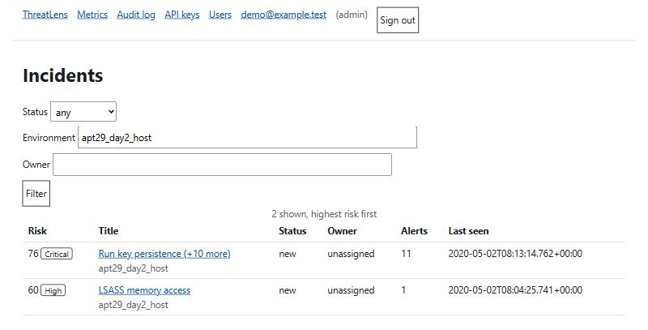
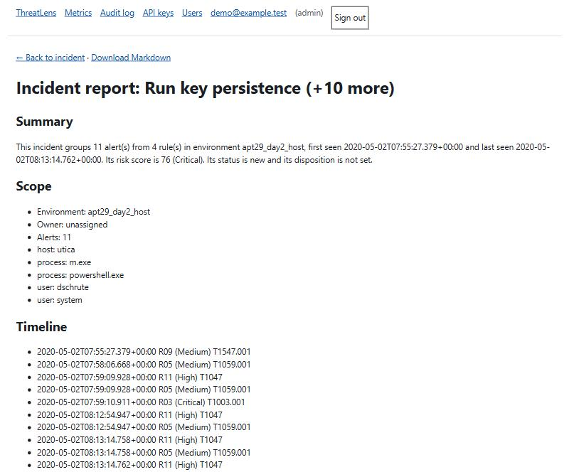

# APT29 investigation: beacon finds it, ThreatLens handles it

This walks through OTRF's public APT29 emulation logs (day 1 and day 2, host data) from beacon's
alerts to ThreatLens incidents, then checks what beacon missed. It is a defensive write-up of
synthetic-lab data. Every number comes from a command in [How to reproduce](#how-to-reproduce).
It replaces the "APT29 incident report" item in beacon's Phase 5.

## 1. Limits

- **Recall is by technique, not by step.** OTRF's emulation plan has no timestamps. A ground-truth
  row counts as detected when a beacon rule for the same technique (or its parent or
  sub-technique) alerted anywhere in that dataset. It does not show that an alert caught step 5.A.
  Real recall is no higher than the numbers below, because a parent or sub-technique match counts
  as detected and a stricter step-level score could only be equal or lower.
- **Dispositions are proposed, not recorded.** Nobody triaged these incidents in the app. Each
  proposed disposition states its basis: the alert's technique is in the ground truth for that
  dataset. An alert with no such match would be marked uncertain. None of the 20 alerts here
  lacks a match.
- **Counts only.** There are no timing metrics (time to acknowledge, time to resolve), because
  there was no analyst.

## 2. What ThreatLens produced

Beacon's demo export has 554 findings. Two environments are APT29. ThreatLens groups alerts that
share a host, user or source IP within a time window (settings in `config/correlation.yml`).

| Environment | Alerts | Incidents | Risk score | Rules that fired |
|---|---|---|---|---|
| `apt29_day1_host` | 8 | 1 | 68 (High) | R03 ×3, R05 ×1, R10 ×4 |
| `apt29_day2_host` | 12 | 2 (11 alerts, 1 alert) | 76 (Critical), 60 (High) | R03 ×2, R05 ×5, R09 ×1, R11 ×4 |

Together: 20 alerts in 3 incidents.

The queue filtered to day 2, and the report for the 11-alert incident (screenshots from a local
database seeded with the same export):




## 3. The incidents

All times are 2020-05-02 UTC.

### Day 1: one incident, 8 alerts, risk 68

- **Hosts and users:** `nashua`, `scranton`; user `pbeesly`; processes `powershell.exe`,
  `wsmprovhost.exe`.
- **Rules and techniques:** R03 LSASS memory access (T1003.001, Critical) 03:05 to 03:09; then
  R10 service installed by a PsExec-style tool (T1569.002, High) ×4, 03:11 to 03:15; then R05
  PowerShell (T1059.001, Medium) at 03:21.
- **Risk factors:** +50 highest severity is Critical, +8 two tactics (Credential Access,
  Execution), +10 Credential Access present.
- **Proposed disposition: true positive.** Basis: T1003, T1059.001 and T1569.002 are all
  ground-truth techniques for `apt29_day1_host`. This is a technique match, not a step match.

### Day 2, incident A: 11 alerts on `utica`, risk 76

- **Hosts and users:** `utica`; users `dschrute` and `system`; processes `m.exe`,
  `powershell.exe`.
- **Rules and techniques:** R09 Run key persistence (T1547.001) at 07:55, then R05 (T1059.001)
  and R11 WMI starts a shell (T1047), R03 (T1003.001) at 07:59, then R11 and R05 pairs at 08:12
  and 08:13.
- **Risk factors:** +50 Critical, +16 three tactics, +10 Credential Access present.
- **Proposed disposition: true positive.** Basis: T1547.001, T1059.001, T1047 and T1003 are all
  ground-truth techniques for `apt29_day2_host`.

### Day 2, incident B: 1 alert on `newyork`, risk 60

- **Host:** `newyork`; process `m.exe`. One R03 alert (T1003.001) at 08:04.
- **Risk factors:** +50 Critical, +10 Credential Access present.
- **Proposed disposition: true positive.** Basis: T1003 is a ground-truth technique for
  `apt29_day2_host`. The same `m.exe` name appears in incident A on another host. ThreatLens links
  alerts by host, user or source IP, not process name, so it kept them apart. A reviewer could
  merge them by hand.

## 4. Found vs missed

Ground truth has 62 rows for day 1 and 57 for day 2: 119 rows over 55 techniques.

| Dataset | Rows detected | Rules that fired on a ground-truth technique |
|---|---|---|
| `apt29_day1_host` | 7 of 62 | R03, R05, R10 |
| `apt29_day2_host` | 6 of 57 | R03, R05, R09, R11 |

106 of 119 rows are missed, across 51 techniques:

- **No rule covers the technique: 47 techniques.** The most-missed are T1057 Process Discovery
  (6 rows), T1033, T1070.004 and T1083 (5 each), then T1005, T1105 and T1560 (4 each).
- **A rule exists but missed some rows: 4 techniques.**

| Technique | Rule | Rows missed | Where |
|---|---|---|---|
| T1547.001 Run keys | R09 | 3 | day 1 (steps 5.B, 10.A, 10.B); R09 fired on day 2 |
| T1204 User Execution | R06 | 2 | day 1 step 1.A, day 2 step 11.A |
| T1136 Create Account | R13 | 1 | day 2 step 20.B |
| T1543.003 New Service | R08 | 1 | day 1 step 5.A |

## 5. Gaps and planned rules

Among the 47 uncovered techniques are T1057 (6 rows), T1033 (5), T1083 (5), T1082 (3), T1016 (2),
T1018 (2), T1012 (1) and T1069 (1). The plan names no technique for any planned rule, so none can
be matched to them.

Phase 3 already shipped R10, R11 and R15. Five rules are still planned: R04, R14, R17, R18 and
R19. For each, the Phase 3 plan records no technique, so this write-up does not claim any of
them closes a gap: **technique not recorded.** Which missed rows each would cover can be decided
only once its technique is set.

## 6. Lessons learned

Following the NIST SP 800-61 cycle:

1. **Detection and analysis.** 20 alerts became 3 incidents, and day 1 read as one chain
   (credential access, then remote service execution, then PowerShell). Grouping is what made it
   readable.
2. **Detection gap.** 47 techniques have no rule, and Discovery produced no alert at all. An
   analyst working only from alerts would not see that stage.
3. **Rule coverage differs by dataset.** R09 caught Run key persistence on day 2 but missed all 3
   rows on day 1. Look at the day 1 persistence events before trusting the rule. The same check
   applies to R06 (2 rows), R13 (1) and R08 (1).
4. **Containment and correlation.** `m.exe` ran on `utica` and `newyork` but did not link
   incidents A and B, because process never links (see `docs/correlation.md`). An analyst should
   merge by hand when the evidence supports it.
5. **Measurement.** Recall here is a technique-level floor with no step timing. Step-level recall
   needs timestamps the emulation plan does not have.

## 7. How to reproduce

ThreatLens, from this repo:

```bash
uv run threatlens import demo/beacon_findings.jsonl --db apt29.db   # 554 findings
uv run python scripts/measure_correlation.py apt29.db               # alerts to incidents per environment
```

Incident reports (timeline, entities, techniques, risk factors) are `/incidents/{id}/report.md`
in the running app, or `app.report.build` and `to_markdown` with `THREATLENS_DB_PATH` set to the
same database.

Beacon, in the [beacon repo](https://github.com/p3rpetualpanda/beacon) with its APT29 data
loaded:

```bash
make detect                                            # recall per dataset: 7 of 62, 6 of 57
uv run beacon coverage --layer docs/apt29-layer.json   # ATT&CK Navigator layer
```

The per-technique miss counts and the 47/4 split come from this query on `data/beacon.duckdb`. A
technique "has a rule" when a rule's technique equals it, is its parent, or is a sub-technique of
it:

```sql
WITH m AS (
  SELECT technique, count(*) AS missed FROM rule_recall WHERE NOT detected GROUP BY 1)
SELECT m.technique, m.missed,
       EXISTS (SELECT 1 FROM rules r
               WHERE r.technique = m.technique
                  OR r.technique = split_part(m.technique, '.', 1)
                  OR split_part(r.technique, '.', 1) = m.technique) AS has_rule
FROM m ORDER BY missed DESC, technique;   -- 51 rows: 47 false, 4 true
```
