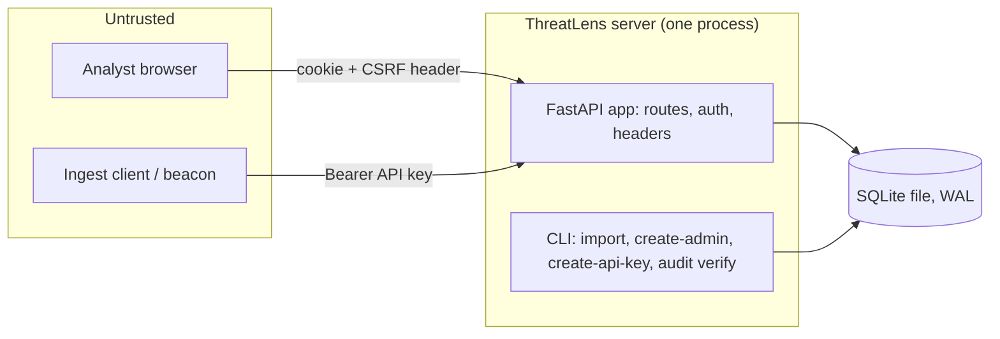

# ThreatLens threat model (state after M3)

Scope: what exists today: the ingest API, login/logout, role and CSRF checks, the audit
log, the read-only incident endpoints, and the SQLite file. The analyst UI (M5), incident
workflow (M4) and reports (M6)
add their own rows when they land. Every mitigation below names the test that proves it.

## Data flow

Trust boundaries: browser to server, ingest client to server, server to the SQLite file.
The CLI runs as the operator on the same machine and is trusted (it needs file access to
the database anyway).

## STRIDE per element

### Analyst browser to server (login, session)

| Threat | Mitigation | Proof |
|---|---|---|
| Spoofing: password guessing | argon2id hashes; 5 failures per 15 min per username and per IP, then 429; unknown usernames count too; the attempt is counted under the write lock before the password is checked, so parallel guesses cannot slip past | `tests/test_lockout.py` (incl. `test_parallel_guesses_cannot_all_pass_the_gate`), `test_five_failures_lock_even_the_right_password`, `test_lock_covers_unknown_usernames_too` |
| Spoofing: account enumeration | Same 401 body for wrong password and unknown email; unknown email costs a dummy argon2 verify | `test_wrong_password_and_unknown_user_look_identical`, `test_wrong_password_and_unknown_user_fail_the_same_way` |
| Spoofing: session fixation | Login always issues a new token; a planted cookie value never becomes a session | `test_login_replaces_a_planted_session_cookie`, `test_tokens_are_random_and_only_a_hash_is_stored` |
| Spoofing: stolen database | Session tokens stored as sha256 only; passwords as argon2id | `test_password_is_stored_as_argon2id_not_plaintext` |
| Tampering: CSRF | Per-session synchronizer token in `X-CSRF-Token` on every non-safe method, plus `SameSite=Strict` | `test_logout_needs_csrf_then_invalidates`, `test_another_sessions_csrf_token_is_rejected`, `test_session_routes_that_change_state_need_the_csrf_header` |
| Information disclosure: cookie theft | `HttpOnly`, `SameSite=Strict`, `Secure` off localhost (decided from the request host), HSTS on https | `test_login_returns_user_and_csrf_and_a_safe_cookie`, `test_cookie_is_secure_off_localhost` |
| Information disclosure: framing, sniffing, caching | CSP (`default-src 'self'`, `frame-ancestors 'none'`), `X-Frame-Options`, `nosniff`, `Referrer-Policy: same-origin`, `no-store` | `test_security_headers_everywhere_but_docs` |
| Repudiation | Login success, lock, logout and user creation are audited; a failed login below the lock threshold is not | `test_login_is_audited_and_the_chain_holds`, `test_logout_is_audited_and_clears_the_cookie`, `test_create_user_is_audited_without_the_password` |
| Elevation of privilege | Roles viewer < analyst < lead < admin, checked on the server after the session | `test_roles_include_the_ones_below`, `tests/test_authz_matrix.py` |
| Denial of service | Idle sessions expire after 8 h, and no session outlives 24 h; login fields capped (254 / 1024 chars); every request body is capped by bytes read (login 4 KB, others 64 KB, ingest 10 MB), chunked or not | `test_idle_expiry_and_sliding_window`, `test_a_busy_session_still_ends_at_the_absolute_limit`, `test_login_rejects_malformed_bodies`, `test_oversized_login_body_is_refused_before_it_is_parsed`, `tests/test_bodylimit.py` |

### Ingest client to server (`POST /api/v1/findings`)

| Threat | Mitigation | Proof |
|---|---|---|
| Spoofing | Bearer key, 256-bit random, only its sha256 stored, scope `ingest`, revocable; every failure is the same 401 | `tests/test_apikeys.py`, `tests/test_api_findings.py` |
| Tampering: malformed or hostile findings | JSON Schema validation against the vendored beacon contract; all-or-nothing transaction; 422 with nothing written | `test_contract.py`, `test_api_findings.py` |
| Denial of service | 10 MB and 5,000-finding limits (413), parsing off the event loop, 503 + `Retry-After` when the database is locked | `test_api_findings.py` |
| Repudiation | One audit row per import naming the key id | `test_ingest_writes_one_audit_row` |
| Elevation of privilege | A user session cannot ingest; an API key cannot reach user routes | `tests/test_authz_matrix.py` |

### Incident endpoints (`GET /api/v1/incidents`, `/{id}`)

| Threat | Mitigation | Proof |
|---|---|---|
| Spoofing, elevation of privilege | Read-only; any logged-in role (viewer and up) sees every environment (no per-environment grants yet). Anonymous and API-key callers get 401 | `tests/test_authz_matrix.py` |
| Tampering: SQL injection through filters | Parameterised SQL; `status` is an enum, `limit` is 1-200, `environment` and the id are length-capped | `test_sql_in_filter_is_just_a_value`, `test_limit_is_capped_at_200` |
| Tampering: hostile finding text shown back | Titles and reasons are JSON strings, never HTML; the security headers stay on every response | `tests/test_incidents_api.py` |
| Repudiation | Automatic merges write an `incident.merge` audit row by `system`; creating incidents is not audited, to keep the log small | `test_audit_row_on_merge` |
| Denial of service | Re-partitioning runs per ingest inside the write lock. Memory is flat; time is quadratic in alerts that share one value inside the window (800 on one host plus 3,200 others stays under 40 MB). Fine to a few thousand (`shortcut:` note in `app/correlate.py`) | `scripts/measure_correlation.py` on the 544-finding export |

### Asset and identity CSV loaders (`threatlens load-assets`, `load-identities`)

| Threat | Mitigation | Proof |
|---|---|---|
| Tampering: a bad or empty file changes scores | Local CLI only, no HTTP route. The header, criticality, flags and duplicates are checked before anything is written; an empty file is refused; the replace is one transaction | `tests/test_enrich.py` |
| Repudiation | Every load writes an `assets.load` or `identities.load` audit row | `test_load_assets_lowercases_and_replaces` |

### Server to SQLite file

| Threat | Mitigation | Proof |
|---|---|---|
| Tampering with the audit log | Hash chain: each row's hash covers the previous hash; `threatlens audit verify` exits 1 and names the first bad row. This catches accidental and naive edits only: the chain alone has no secret, so someone who can write the file can rewrite the rows and recompute the hashes unless anchoring is on (gap 1) | `test_editing_any_field_is_detected`, `test_deleting_a_middle_row_is_detected`, `test_cli_verify_ok_and_tampered`, `tests/test_anchor.py` |
| Tampering during migration | Each migration is one transaction; a failed or raced migration leaves no half schema | `tests/test_migrations.py` |
| Secrets at rest | No default admin; `create-admin` reads a prompt or `$THREATLENS_ADMIN_PASSWORD`; passwords and tokens never reach the audit log | `test_cli_create_admin_*`, `test_api_key_create_and_revoke_are_audited` |
| Admin pages: key token exposure | The token is shown once, after a POST-redirect, from a 60 s HttpOnly, SameSite=Strict cookie scoped to `/admin/keys` (`Secure` off localhost, deleted on the first view); it is not in a URL, the audit detail or any database table (the keys table holds only its hash), and only the key name waits in the one-shot `flash` row; responses are `no-store`; a refresh cannot make a second key | `test_admin_creates_a_key_that_works_and_is_shown_once`, `test_refreshing_the_create_post_page_shows_no_token_and_makes_no_second_key` |
| Admin pages: role and CSRF | `/audit` needs lead, `/admin/keys` needs admin; POSTs run the session, Origin, role, CSRF gate | `tests/test_authz_matrix.py`, `test_key_pages_are_admin_only`, `test_key_name_is_required_and_a_wrong_csrf_creates_nothing` |
| Admin pages: account changes | Only an admin; never your own account; the last active admin stays (checked inside the write transaction); disabling deletes the user's sessions, and login, session lookup and incident assignment all refuse a disabled account; every change writes an audit row (`user.create`, `user.role`, `user.disable`, `user.enable`) with no password in it; a new user's password is typed by the admin and is never stored or logged in plain text | `tests/test_accounts.py`, `test_account_rules_show_as_error_pages`, `test_account_posts_need_csrf_and_an_admin`, `test_changing_a_role_and_disabling_through_the_forms` |
| Admin pages: spoofed names or messages | Key names reject control and bidi characters and are autoescaped; the success message comes from a server-side one-shot slot, never from the query | `test_key_name_is_required_and_a_wrong_csrf_creates_nothing`, `test_success_shows_a_fixed_message_once` |
| Audit page: login details | Leads do not see `login.*` rows at all (client IPs, emails anyone typed); admins see everything | `test_leads_do_not_see_login_rows_but_admins_do` |
| Audit page load | Migration 008 makes `audit_log` append-only through SQL (triggers block UPDATE and DELETE), so each view checks only rows after the last clean check. If the triggers are missing (someone rewrote the file), every view checks the whole chain (0.24 s per 50,000 rows); it also does so every 10 minutes regardless. Each worker keeps its own checkpoint, which is safe for the same reason. `threatlens audit verify` is always a full pass | `test_the_log_cannot_be_edited_or_deleted_through_sql`, `test_audit_check_sees_a_middle_edit_at_once_when_the_triggers_are_gone`, `test_an_old_row_edit_shows_after_the_full_pass_interval`, `test_between_full_passes_new_rows_and_the_checkpoint_row_are_still_checked` |

## Known gaps (accepted for now)

1. **Audit log: a rewrite is caught only if anchoring is on, and only back to the last anchor.**
   Migration 008 blocks UPDATE and DELETE through SQL, but the hash chain is unkeyed. With
   `THREATLENS_AUDIT_KEY_FILE` and `THREATLENS_AUDIT_ANCHOR` set and `threatlens audit anchor`
   run on a schedule (hourly), the newest row hash is signed (HMAC-SHA256) into an append-only
   file. `audit verify` and the audit page then fail on a forged line, a rewritten or cut row
   that was anchored, a deleted newest line (anchor too old) or a wrong key. Limits: rows added
   after the newest anchor rest on the unkeyed chain until the next one; someone holding the
   database, the key and the anchor file together can still rewrite everything, so the anchor
   file must be shipped off the machine and the key kept off it (tests cannot prove the
   shipping). With anchoring off, the page says so.
2. **Lockout as a weapon:** anyone can lock a known username for 15 minutes by failing five
   times. Chosen over letting an attacker guess freely.
3. **IP key behind a proxy:** the lock uses the client address uvicorn reports. With
   `--proxy-headers --forwarded-allow-ips=<proxy address>` that is the forwarded address
   (`tests/test_proxy.py`); without the flags, or with `*`, it is the proxy's own address (one
   shared bucket) or whatever a client forges. Operators must set the allow-list correctly.
4. **Ingest key failures are throttled per address (429).** Keys are 256-bit, so guessing is not
   feasible; the cost is that one address can be locked out of ingest for 15 minutes.
5. **Account recovery is operator-only.** Admins manage users in the UI; a forgotten password is reset
   with `threatlens user set-password EMAIL` (ends sessions, audited). No email reset by design.
6. **Stored XSS:** `tests/test_ui.py` renders a hostile title, rule, host, user, comment and
   author on the queue and detail pages and asserts they are escaped. Alert detail (M5c) adds its own.
   `tests/test_report.py` does the same for the HTML report and, with Markdown link and heading
   payloads, for `report.md` (every stored value is escaped for Markdown).
7. **`/docs`, `/redoc` and `/openapi.json` are off by default** (`THREATLENS_DOCS=1` turns
   them on, as `make demo` does). When on, they have no CSP because Swagger UI loads scripts
   from a CDN, so do not enable them in production.
8. **Body caps count gzip bodies at their compressed size.** Request bodies are capped by bytes
   read (app/bodylimit.py: 4 KB login, 64 KB default, 10 MB ingest), so chunked and lying
   `Content-Length` bodies get 413. A proxy limit is still good defence in depth.
9. **Unhandled 500s skip the security headers** (Starlette answers them outside the
   middleware). The body is plain text.
10. **Every authenticated request writes** the sliding expiry, so a long ingest can make
    analyst requests wait for the write lock (503 after 30 s).
11. **`Secure` and HSTS depend on the proxy setup.** They follow the request scheme, which is
    https only when a trusted proxy sends `X-Forwarded-Proto: https`. A proxy that is not on
    the allow-list gets plain-http behaviour: no HSTS, and cookies `Secure` only off localhost.
    `X-Forwarded-Host` is not read, so the proxy must pass the original `Host` header.
12. **Incident write routes (M5a) read the role before the transaction starts.** A session
    demoted or revoked in that few-millisecond window can still finish one action. Every action
    is audited with the actor.
13. **Split-off and merged incidents** get title, times and score recomputed, but `too_common`
    and `related_incident` keep their old values until the next correlation run.
14. **Form login has no CSRF token.** It refuses a request whose `Origin` header names another
    host (browsers always send it on a cross-site POST) and sets only a fresh session. A client
    that sends no `Origin` is not a browser attack.

15. **Form actions (M5c).** HTML forms cannot send the CSRF header, so `POST /incidents/{id}/*`
    and `POST /logout` compare a hidden `csrf` field to the session token (constant time, empty
    never matches) and refuse a cross-site `Origin`. Session first, then body: an anonymous post
    is redirected before any body is read. Body caps: 4 KB, 32 KB for comment and split. Refusals
    re-render a page; no user text goes into a URL. Proof: `tests/test_ui_actions.py`.
16. **Alert page.** `/alerts/{uid}` shows the stored finding to any logged-in role and is not
    scoped by environment, like the incident pages. Revisit if environments become access-scoped.
