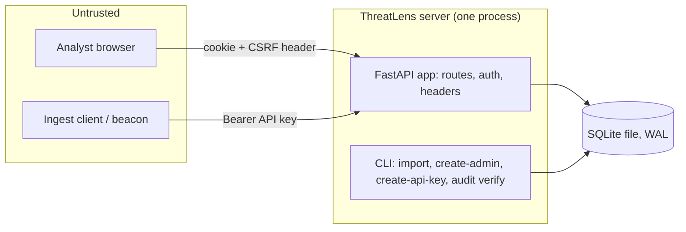

# ThreatLens threat model (state after M2)

Scope: what exists today: the ingest API, login/logout, role and CSRF checks, the audit
log, and the SQLite file. The analyst UI (M5), incident workflow (M3-M4) and reports (M6)
add their own rows when they land. Every mitigation below names the test that proves it.

## Data flow

Trust boundaries: browser to server, ingest client to server, server to the SQLite file.
The CLI runs as the operator on the same machine and is trusted (it needs file access to
the database anyway).

## STRIDE per element

### Analyst browser to server (login, session)

| Threat | Mitigation | Proof |
|---|---|---|
| Spoofing: password guessing | argon2id hashes; 5 failures per 15 min per username and per IP, then 429; unknown usernames count too | `tests/test_lockout.py`, `test_five_failures_lock_even_the_right_password`, `test_lock_covers_unknown_usernames_too` |
| Spoofing: account enumeration | Same 401 body for wrong password and unknown email; unknown email costs a dummy argon2 verify | `test_wrong_password_and_unknown_user_look_identical`, `test_wrong_password_and_unknown_user_fail_the_same_way` |
| Spoofing: session fixation | Login always issues a new token; a planted cookie value never becomes a session | `test_login_replaces_a_planted_session_cookie`, `test_tokens_are_random_and_only_a_hash_is_stored` |
| Spoofing: stolen database | Session tokens stored as sha256 only; passwords as argon2id | `test_password_is_stored_as_argon2id_not_plaintext` |
| Tampering: CSRF | Per-session synchronizer token in `X-CSRF-Token` on every non-safe method, plus `SameSite=Strict` | `test_logout_needs_csrf_then_invalidates`, `test_another_sessions_csrf_token_is_rejected`, `test_session_routes_that_change_state_need_the_csrf_header` |
| Information disclosure: cookie theft | `HttpOnly`, `SameSite=Strict`, `Secure` off localhost, HSTS on https | `test_login_returns_user_and_csrf_and_a_safe_cookie`, `test_cookie_is_secure_off_localhost` |
| Information disclosure: framing, sniffing, caching | CSP (`default-src 'self'`, `frame-ancestors 'none'`), `X-Frame-Options`, `nosniff`, `no-referrer`, `no-store` | `test_security_headers_everywhere_but_docs` |
| Repudiation | Login success, lock, logout and user creation are audited | `test_login_is_audited_and_the_chain_holds`, `test_create_user_is_audited_without_the_password` |
| Elevation of privilege | Roles viewer < analyst < lead < admin, checked on the server after the session | `test_roles_include_the_ones_below`, `tests/test_authz_matrix.py` |
| Denial of service | Idle sessions expire after 8 h; login body capped (254 / 1024 chars) | `test_idle_expiry_and_sliding_window`, `test_login_rejects_malformed_bodies` |

### Ingest client to server (`POST /api/v1/findings`)

| Threat | Mitigation | Proof |
|---|---|---|
| Spoofing | Bearer key, 256-bit random, only its sha256 stored, scope `ingest`, revocable; every failure is the same 401 | `tests/test_apikeys.py`, `tests/test_api_findings.py` |
| Tampering: malformed or hostile findings | JSON Schema validation against the vendored beacon contract; all-or-nothing transaction; 422 with nothing written | `test_contract.py`, `test_api_findings.py` |
| Denial of service | 10 MB and 5,000-finding limits (413), parsing off the event loop, 503 + `Retry-After` when the database is locked | `test_api_findings.py` |
| Repudiation | One audit row per import naming the key id | `test_ingest_writes_one_audit_row` |
| Elevation of privilege | A user session cannot ingest; an API key cannot reach user routes | `tests/test_authz_matrix.py` |

### Server to SQLite file

| Threat | Mitigation | Proof |
|---|---|---|
| Tampering with the audit log | Hash chain: each row's hash covers the previous hash; `threatlens audit verify` exits 1 and names the first bad row | `test_editing_any_field_is_detected`, `test_deleting_a_middle_row_is_detected`, `test_cli_verify_ok_and_tampered` |
| Tampering during migration | Each migration is one transaction; a failed or raced migration leaves no half schema | `tests/test_migrations.py` |
| Secrets at rest | No default admin; `create-admin` reads a prompt or `$THREATLENS_ADMIN_PASSWORD`; passwords and tokens never reach the audit log | `test_cli_create_admin_*`, `test_api_key_create_and_revoke_are_audited` |

## Known gaps (accepted for now)

1. **Tail truncation:** deleting the newest audit rows is not detectable from the log alone.
   Keep an offsite copy of the latest hash if that matters.
2. **Lockout as a weapon:** anyone can lock a known username for 15 minutes by failing five
   times. Chosen over letting an attacker guess freely.
3. **IP key behind a proxy:** the lock uses the socket peer address. Behind a reverse proxy
   every client looks the same until forwarded addresses are trusted.
4. **No rate limit on the ingest 401 path.** Keys are 256-bit, so guessing is not feasible,
   but the endpoint can still be hammered.
5. **No user-management routes yet.** Users come from the CLI only; admin routes arrive with
   the M5 UI. Until then there is no way to revoke a key or session from the API.
6. **Stored XSS tests:** no page renders finding fields yet. The "hostile finding renders
   escaped on every page" test is added with the UI in M5.
7. **`/docs` and `/redoc` have no CSP** because Swagger UI loads scripts from a CDN. Turn
   them off in production.
