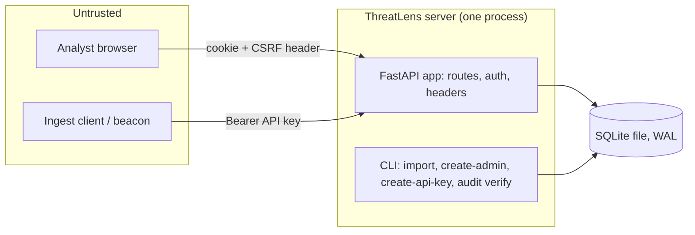

# ThreatLens threat model (state after M3)

Scope: what exists today: the ingest API, login/logout, role and CSRF checks, the audit
log, the read-only incident endpoints, and the SQLite file. The analyst UI (M5), incident
workflow (M4) and reports (M6)
add their own rows when they land. Every mitigation below names the test that proves it.

## Data flow

Trust boundaries: browser to server, ingest client to server, server to the SQLite file.
The CLI runs as the operator on the same machine and is trusted (it needs file access to
the database anyway).

## STRIDE per element

### Analyst browser to server (login, session)

| Threat | Mitigation | Proof |
|---|---|---|
| Spoofing: password guessing | argon2id hashes; 5 failures per 15 min per username and per IP, then 429; unknown usernames count too; the attempt is counted under the write lock before the password is checked, so parallel guesses cannot slip past | `tests/test_lockout.py` (incl. `test_parallel_guesses_cannot_all_pass_the_gate`), `test_five_failures_lock_even_the_right_password`, `test_lock_covers_unknown_usernames_too` |
| Spoofing: account enumeration | Same 401 body for wrong password and unknown email; unknown email costs a dummy argon2 verify | `test_wrong_password_and_unknown_user_look_identical`, `test_wrong_password_and_unknown_user_fail_the_same_way` |
| Spoofing: session fixation | Login always issues a new token; a planted cookie value never becomes a session | `test_login_replaces_a_planted_session_cookie`, `test_tokens_are_random_and_only_a_hash_is_stored` |
| Spoofing: stolen database | Session tokens stored as sha256 only; passwords as argon2id | `test_password_is_stored_as_argon2id_not_plaintext` |
| Tampering: CSRF | Per-session synchronizer token in `X-CSRF-Token` on every non-safe method, plus `SameSite=Strict` | `test_logout_needs_csrf_then_invalidates`, `test_another_sessions_csrf_token_is_rejected`, `test_session_routes_that_change_state_need_the_csrf_header` |
| Information disclosure: cookie theft | `HttpOnly`, `SameSite=Strict`, `Secure` off localhost (decided from the request host), HSTS on https | `test_login_returns_user_and_csrf_and_a_safe_cookie`, `test_cookie_is_secure_off_localhost` |
| Information disclosure: framing, sniffing, caching | CSP (`default-src 'self'`, `frame-ancestors 'none'`), `X-Frame-Options`, `nosniff`, `Referrer-Policy: same-origin`, `no-store` | `test_security_headers_everywhere_but_docs` |
| Repudiation | Login success, lock, logout and user creation are audited; a failed login below the lock threshold is not | `test_login_is_audited_and_the_chain_holds`, `test_logout_is_audited_and_clears_the_cookie`, `test_create_user_is_audited_without_the_password` |
| Elevation of privilege | Roles viewer < analyst < lead < admin, checked on the server after the session | `test_roles_include_the_ones_below`, `tests/test_authz_matrix.py` |
| Denial of service | Idle sessions expire after 8 h, and no session outlives 24 h; login fields capped (254 / 1024 chars) and a declared body over 4 KB gets 413 | `test_idle_expiry_and_sliding_window`, `test_a_busy_session_still_ends_at_the_absolute_limit`, `test_login_rejects_malformed_bodies`, `test_oversized_login_body_is_refused_before_it_is_parsed` |

### Ingest client to server (`POST /api/v1/findings`)

| Threat | Mitigation | Proof |
|---|---|---|
| Spoofing | Bearer key, 256-bit random, only its sha256 stored, scope `ingest`, revocable; every failure is the same 401 | `tests/test_apikeys.py`, `tests/test_api_findings.py` |
| Tampering: malformed or hostile findings | JSON Schema validation against the vendored beacon contract; all-or-nothing transaction; 422 with nothing written | `test_contract.py`, `test_api_findings.py` |
| Denial of service | 10 MB and 5,000-finding limits (413), parsing off the event loop, 503 + `Retry-After` when the database is locked | `test_api_findings.py` |
| Repudiation | One audit row per import naming the key id | `test_ingest_writes_one_audit_row` |
| Elevation of privilege | A user session cannot ingest; an API key cannot reach user routes | `tests/test_authz_matrix.py` |

### Incident endpoints (`GET /api/v1/incidents`, `/{id}`)

| Threat | Mitigation | Proof |
|---|---|---|
| Spoofing, elevation of privilege | Read-only; any logged-in role (viewer and up) sees every environment (no per-environment grants yet). Anonymous and API-key callers get 401 | `tests/test_authz_matrix.py` |
| Tampering: SQL injection through filters | Parameterised SQL; `status` is an enum, `limit` is 1-200, `environment` and the id are length-capped | `test_sql_in_filter_is_just_a_value`, `test_limit_is_capped_at_200` |
| Tampering: hostile finding text shown back | Titles and reasons are JSON strings, never HTML; the security headers stay on every response | `tests/test_incidents_api.py` |
| Repudiation | Automatic merges write an `incident.merge` audit row by `system`; creating incidents is not audited, to keep the log small | `test_audit_row_on_merge` |
| Denial of service | Re-partitioning runs per ingest inside the write lock. Memory is flat; time is quadratic in alerts that share one value inside the window (800 on one host plus 3,200 others stays under 40 MB). Fine to a few thousand (`shortcut:` note in `app/correlate.py`) | `scripts/measure_correlation.py` on the 544-finding export |

### Asset and identity CSV loaders (`threatlens load-assets`, `load-identities`)

| Threat | Mitigation | Proof |
|---|---|---|
| Tampering: a bad or empty file changes scores | Local CLI only, no HTTP route. The header, criticality, flags and duplicates are checked before anything is written; an empty file is refused; the replace is one transaction | `tests/test_enrich.py` |
| Repudiation | Every load writes an `assets.load` or `identities.load` audit row | `test_load_assets_lowercases_and_replaces` |

### Server to SQLite file

| Threat | Mitigation | Proof |
|---|---|---|
| Tampering with the audit log | Hash chain: each row's hash covers the previous hash; `threatlens audit verify` exits 1 and names the first bad row. This catches accidental and naive edits only: there is no secret and no trigger, so someone who can write the file can rewrite the rows and recompute the hashes (gap 1) | `test_editing_any_field_is_detected`, `test_deleting_a_middle_row_is_detected`, `test_cli_verify_ok_and_tampered` |
| Tampering during migration | Each migration is one transaction; a failed or raced migration leaves no half schema | `tests/test_migrations.py` |
| Secrets at rest | No default admin; `create-admin` reads a prompt or `$THREATLENS_ADMIN_PASSWORD`; passwords and tokens never reach the audit log | `test_cli_create_admin_*`, `test_api_key_create_and_revoke_are_audited` |
| Admin pages: key token exposure | The token is shown once, after a POST-redirect, from a 60 s HttpOnly, SameSite=Strict cookie scoped to `/admin/keys` (`Secure` off localhost, deleted on the first view); it is not in a URL, the audit detail or any database table (the keys table holds only its hash), and only the key name waits in the one-shot `flash` row; responses are `no-store`; a refresh cannot make a second key | `test_admin_creates_a_key_that_works_and_is_shown_once`, `test_refreshing_the_create_post_page_shows_no_token_and_makes_no_second_key` |
| Admin pages: role and CSRF | `/audit` needs lead, `/admin/keys` needs admin; POSTs run the session, Origin, role, CSRF gate | `tests/test_authz_matrix.py`, `test_key_pages_are_admin_only`, `test_key_name_is_required_and_a_wrong_csrf_creates_nothing` |
| Admin pages: spoofed names or messages | Key names reject control and bidi characters and are autoescaped; the success message comes from a server-side one-shot slot, never from the query | `test_key_name_is_required_and_a_wrong_csrf_creates_nothing`, `test_success_shows_a_fixed_message_once` |
| Audit page: login details | Leads do not see `login.*` rows at all (client IPs, emails anyone typed); admins see everything | `test_leads_do_not_see_login_rows_but_admins_do` |
| Audit page load | Each view checks only rows added since the last clean check (and that the checkpoint row is unchanged); the whole chain (0.24 s per 50,000 rows) is re-checked every 10 minutes, so an edit to an old row can stay unseen for up to 10 minutes. `threatlens audit verify` is always a full pass | `test_audit_check_sees_a_middle_edit_after_the_full_pass_interval`, `test_between_full_passes_new_rows_and_the_checkpoint_row_are_still_checked` |

## Known gaps (accepted for now)

1. **Audit log is not tamper-proof:** the hash chain is unkeyed and nothing blocks UPDATE or
   DELETE. A writer of the database file can rewrite rows and recompute every later hash, or
   cut rows off the tail, and `verify` will not notice. Upgrade path: HMAC with a key held
   outside the database, `BEFORE UPDATE/DELETE` triggers, and an offsite copy of the latest hash.
2. **Lockout as a weapon:** anyone can lock a known username for 15 minutes by failing five
   times. Chosen over letting an attacker guess freely.
3. **IP key behind a proxy:** the lock uses the socket peer address. Behind a reverse proxy
   every client looks the same until forwarded addresses are trusted.
4. **No rate limit on the ingest 401 path.** Keys are 256-bit, so guessing is not feasible,
   but the endpoint can still be hammered.
5. **No user-management routes or account disable yet.** Users come from the CLI only; admin
   routes arrive with the M5 UI. Until then nothing (API or CLI) can revoke a session, disable
   an account or reset a password except editing the SQLite file.
6. **Stored XSS:** `tests/test_ui.py` renders a hostile title, rule, host, user, comment and
   author on the queue and detail pages and asserts they are escaped. Alert detail (M5c) adds its own.
7. **`/docs` and `/redoc` have no CSP** because Swagger UI loads scripts from a CDN. Turn
   them off in production.
8. **Login body cap trusts `Content-Length`;** a chunked body skips it. Put a body limit on the
   reverse proxy.
9. **Unhandled 500s skip the security headers** (Starlette answers them outside the
   middleware). The body is plain text.
10. **Every authenticated request writes** the sliding expiry, so a long ingest can make
    analyst requests wait for the write lock (503 after 30 s).
11. **`Secure` and HSTS come from the request**, not from a setting. Behind a TLS-terminating
    proxy they need forwarded headers to be trusted.
12. **Incident write routes (M5a) read the role before the transaction starts.** A session
    demoted or revoked in that few-millisecond window can still finish one action. Every action
    is audited with the actor.
13. **Split-off and merged incidents** get title, times and score recomputed, but `too_common`
    and `related_incident` keep their old values until the next correlation run.
14. **Form login has no CSRF token.** It refuses a request whose `Origin` header names another
    host (browsers always send it on a cross-site POST) and sets only a fresh session. A client
    that sends no `Origin` is not a browser attack.

15. **Form actions (M5c).** HTML forms cannot send the CSRF header, so `POST /incidents/{id}/*`
    and `POST /logout` compare a hidden `csrf` field to the session token (constant time, empty
    never matches) and refuse a cross-site `Origin`. Session first, then body: an anonymous post
    is redirected before any body is read. Body caps: 4 KB, 32 KB for comment and split. Refusals
    re-render a page; no user text goes into a URL. Proof: `tests/test_ui_actions.py`.
16. **Alert page.** `/alerts/{uid}` shows the stored finding to any logged-in role and is not
    scoped by environment, like the incident pages. Revisit if environments become access-scoped.
